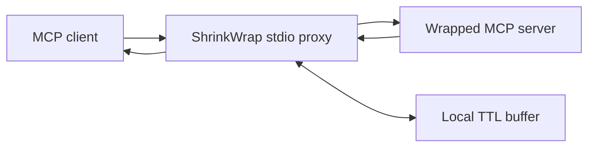

# Architecture

ShrinkWrap runs between a local MCP client and a stdio MCP server. The proxy forwards client requests to the server and inspects server responses before the client receives them.

## Stdio message flow

- The proxy forwards messages it does not change as their original bytes. This includes initialization, notifications, and small tool results.
- On the first page of `tools/list`, it appends a `shrinkwrap_fetch` definition if the wrapped server has no tool with that name. Calls to this added tool are answered by the proxy from its buffer. Other calls go to the wrapped server.
- For a `tools/call` result, it examines text blocks in `result.content`. JSON text containing an object or array is parsed for a structural summary; other text is treated as text. Non-text blocks pass through.
- `result.structuredContent` is redacted but not compacted. Some clients validate it against an output schema, so redaction can make a strict schema check fail. A large structured result can therefore limit overall token savings.

The HTTP module is a Python response transformer. It does not provide an HTTP listener, request forwarding, tool discovery, or the `shrinkwrap_fetch` tool.

## Compaction decision

The engine converts input to text, redacts recognized secrets, estimates tokens, and compares that estimate with a threshold. For larger input it creates a bounded candidate summary: counts and short samples for JSON, or short excerpts for text and errors. It writes the redacted payload to the buffer only if the candidate is estimated to be smaller. If storage fails, it returns the redacted input instead of an unusable reference.

Token counts use a character and word heuristic. They are useful for a local decision and analytics, but they are not model tokenizer counts or billing data.

## Retrieval

Both `shrinkwrap fetch` and the stdio `shrinkwrap_fetch` tool read the same buffer. A reference identifies the full redacted payload for one hour by default. An optional [JSON Pointer](https://www.rfc-editor.org/rfc/rfc6901) selects a nested value. `offset` and `limit` split its text representation into character chunks. For an object or array, concatenate chunks before parsing the JSON. The MCP tool defaults to 4,000 characters and allows at most 16,000 per call.

The buffer stores smaller entries as JSON. For entries of at least 64 KiB, it uses gzip JSON when that saves at least 10% of the bytes. Existing plain JSON entries remain readable. File modification times determine expiry; periodic cleanup removes old entries. The buffer directory and newly written files are owner-only. `SHRINKWRAP_STATE_DIR` can relocate both the buffer and analytics files when set before process startup.

Handles are 12 hexadecimal characters from a SHA-256 digest. They identify cached content; they are not authentication tokens. Redaction is best effort, so use care with unusually sensitive payloads.

## Supported scope

| Surface | Behavior |
| --- | --- |
| Local stdio MCP server | Request forwarding, text compaction, and `shrinkwrap_fetch` retrieval |
| HTTP response transformer API | Text compaction and structured result redaction when embedded by a separate HTTP transport |
| Shell command output | No automatic interception |
| Hosted tools and connected apps | No automatic interception |

See the [MCP tools specification](https://modelcontextprotocol.io/specification/2025-11-25/server/tools) for the `tools/list`, `tools/call`, and result formats used by the proxy.
